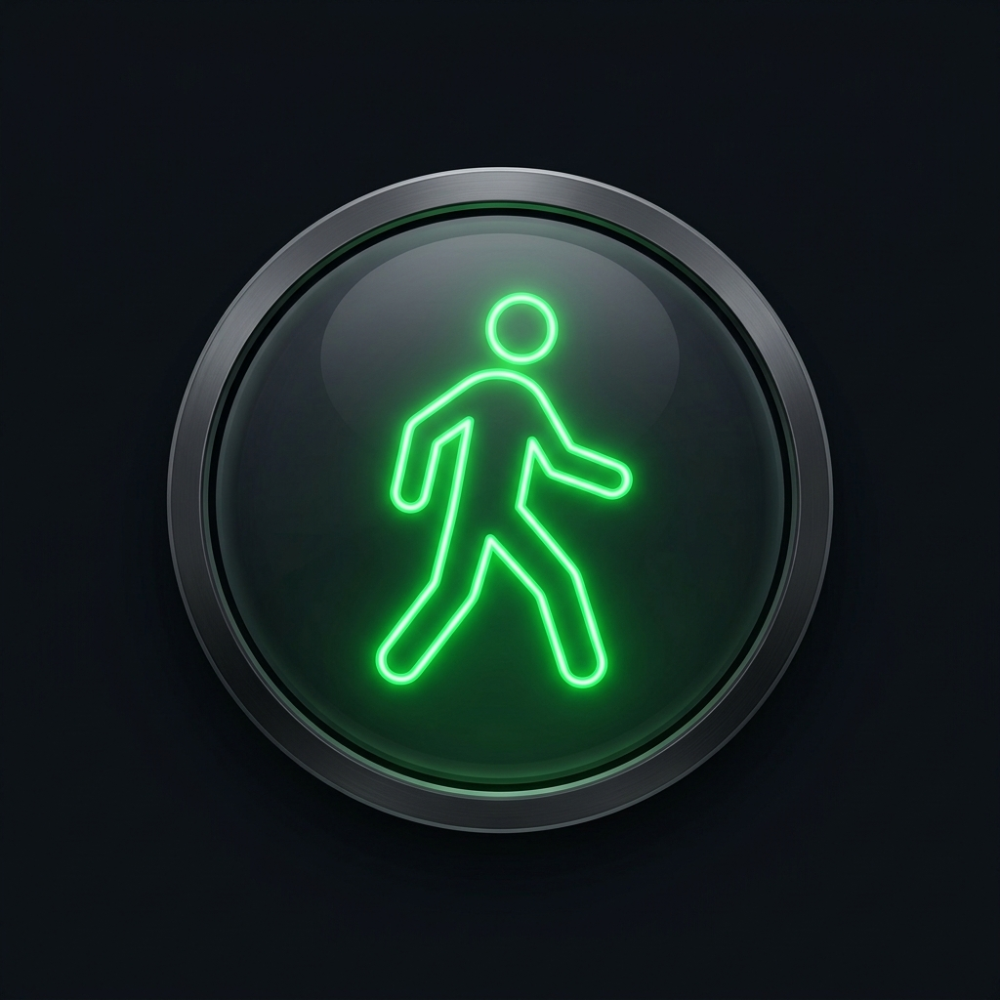

# GreenWalk 🚶‍♂️🚦 – תזמון רמזורים להולכי רגל

> **תכנון יציאה מדויק להגעה באור ירוק לשני רמזורים עוקבים ללא עצירה מיותרת!**



GreenWalk היא אפליקציה מתקדמת, פונקציונלית ובעלת עיצוב יוקרתי (AMOLED Dark) המיועדת לעזור להולכי רגל לתזמן את יציאתם מראש, כך שיגיעו לשני רמזורים עוקבים לאורך מסלול ההליכה שלהם בדיוק כאשר דולק בהם אור ירוק.

הפרויקט בנוי בסטנדרטים הגבוהים ביותר, וכולל:
1. **אפליקציית Android מקורית (Native)** ב-Kotlin ו-Jetpack Compose עם תמיכה מלאה ב-RTL, מותאמת במיוחד למכשירי סמסונג אנדרואיד ומסכי מובייל.
2. **אפליקציית Web מודרנית** ב-React, TypeScript ו-Vite עם שמירת נתונים ב-`localStorage`.
3. **מערך בדיקות אוטומטיות (Unit Tests)** ב-Robolectric (Android) וב-Vitest (Web) המכסה את כל מקרי הקצה.
4. **תהליך CI/CD אוטומטי מלא ב-GitHub Actions** שבונה, בודק, אורז ומפרסם Releases אוטומטית עם כל Git Tag חדש (`v*`).

---

## 🌟 תכונות מרכזיות (Key Features)

- **מחשבון "מתי לצאת לדרך" (When to Leave Hero):**
  מחשב את חלון היציאה המדויק על בסיס זמני ההליכה, מרווח הביטחון ומחזורי הרמזורים, ומציג ספירה לאחור חיה ("צא בעוד: 01:45" או "צא עכשיו!").
- **מערכת מדידת רמזורים בלייב:**
  שני כפתורים ייעודיים: `"רמזור ראשון – הפך לירוק"` ו-`"רמזור שני – הפך לירוק"`. לחיצה שומרת את החותמת בדיוק של אלפיות שניה, כולל מנגנון מניעת לחיצה כפולה (Debounce).
- **אלגוריתם למידת מחזוריות ורמת ביטחון (Confidence Engine):**
  חישוב ממוצע מחזורים וסטיית תקן. מציג ציון מהימנות (0-100%) ודורש מספר מדידות לפני קביעת תחזית.
- **מדידת משך אור ירוק:**
  אפשרות למדוד גם את רגע ההתחלפות לאדום לקביעת חלון הירוק המדויק.
- **טיפול במעבר חצות (Midnight Rollover):**
  חישובי Epoch Timestamps המטפלים בצורה חלקה במעבר שעות מחצות ליום הבא.
- **הזנת זמנים ידנית (Manual Override):**
  הגדרת מחזורים, משכי ירוק והיסטים ידנית ללא צורך במדידה ברחוב.
- **שמירת נתונים מקומית:**
  ב-Android באמצעות `SharedPreferences`, וב-Web באמצעות `localStorage`. כל הנתונים נשמרים לאחר סגירת האפליקציה.
- **הודעת בטיחות קבועה:**
  התחזיות הן הערכות בלבד. יש לציית לרמזורים בפועל ולחצות רק באור ירוק!

---

## 🏗️ מבנה הפרויקט (Project Structure)

```text
├── .github/
│   └── workflows/
│       └── release.yml        # GitHub Actions CI/CD לשחרור אוטומטי
├── app/                       # קוד מקור Android (Kotlin & Jetpack Compose)
│   ├── src/
│   │   ├── main/
│   │   │   ├── java/com/example/
│   │   │   │   ├── logic/     # מנוע חישוב זמנים ומחזורים
│   │   │   │   ├── model/     # טיפוסי נתונים
│   │   │   │   ├── data/      # מאגר שמירה ב-SharedPreferences
│   │   │   │   ├── viewmodel/ # ניהול State וטיימר חי
│   │   │   │   └── ui/        # מסכי ורכיבי Compose (RTL, Dark Theme)
│   │   │   └── res/           # אייקונים מותאמים, משאבים וגרפיקה
│   │   └── test/              # בדיקות יחידה ו-Robolectric
│   └── build.gradle.kts
├── src/                       # קוד מקור Web (React + TypeScript)
│   ├── engine.ts              # מנוע החישובים ב-TypeScript
│   ├── engine.test.ts         # בדיקות Vitest
│   ├── types.ts               # הגדרות Types
│   ├── App.tsx                # ממשק משתמש מלא בעברית (RTL)
│   └── index.css              # עיצוב Samsung Dark AMOLED
├── package.json               # פקודות ותלויות Web
├── tsconfig.json              # הגדרות TypeScript
├── vite.config.ts             # הגדרות Build
└── README.md                  # תיעוד מלא
```

---

## 🧪 הרצת בדיקות אוטומטיות (Running Tests)

### בדיקות Android (JVM / Robolectric):
```bash
gradle :app:testDebugUnitTest
```
הבדיקות מוודאות:
- חישוב מחזורים עקביים.
- התנהגות במדידה בודדת (חוסר נתונים).
- מעבר מחצות ליום הבא.
- טיפול ברמזורים בעלי מחזורים שונים.
- תכנון יציאה וגל ירוק.
- הזנה ידנית.

### בדיקות Web (TypeScript & Vitest):
```bash
npm run test
```

---

## 🚀 תהליך GitHub CI/CD ושחרור גרסאות אוטומטי

הפרויקט כולל Workflow מוכן ב-`.github/workflows/release.yml`.

### כיצד לשחרר גרסה חדשה ב-GitHub:
1. ודאו שהקוד נדחף ל-Repository שלכם ב-GitHub:
   ```bash
   git add .
   git commit -m "feat: complete GreenWalk application"
   git push origin main
   ```
2. צרו Git Tag חדש בפורמט `v*` (לדוגמה `v1.0.0`):
   ```bash
   git tag v1.0.0
   git push origin v1.0.0
   ```
3. ה-GitHub Action יופעל אוטומטית ויבצע:
   - בדיקת קוד והתקנת תלויות (`npm ci`).
   - הרצת כל הבדיקות האוטומטיות (`npm run test`).
   - בדיקת טיפוסים (`npm run typecheck`).
   - יצירת Production Build (`npm run build`).
   - אריזת ה-Build לקובץ ZIP ייעודי: `greenwalk-v1.0.0.zip`.
   - יצירת GitHub Release אוטומטי עם Release Notes מלאים וצירוף קובץ ה-ZIP.

---

## 📱 הרצת האפליקציה באנדרואיד (Android Studio)

1. פתחו את תיקיית הפרויקט ב-Android Studio.
2. המתינו לסנכרון Gradle.
3. לחצו על **Run** להפעלה במכשיר פיזי (מומלץ מכשיר סמסונג) או באמולטור.

---

## 💻 הרצת אפליקציית ה-Web מקומית

```bash
npm install
npm run dev
```
האפליקציה תפעל בכתובת `http://localhost:5173`.

---

## 🛡️ הצהרת בטיחות
התחזיות והחישובים באפליקציה הם הערכות בלבד המבוססות על מחזוריות סטטיסטית. יש לציית תמיד לרמזורים בפועל, לשמור על כללי התנועה ולחצות כביש אך ורק באור ירוק ולאחר בדיקת בטיחות הדרך.
